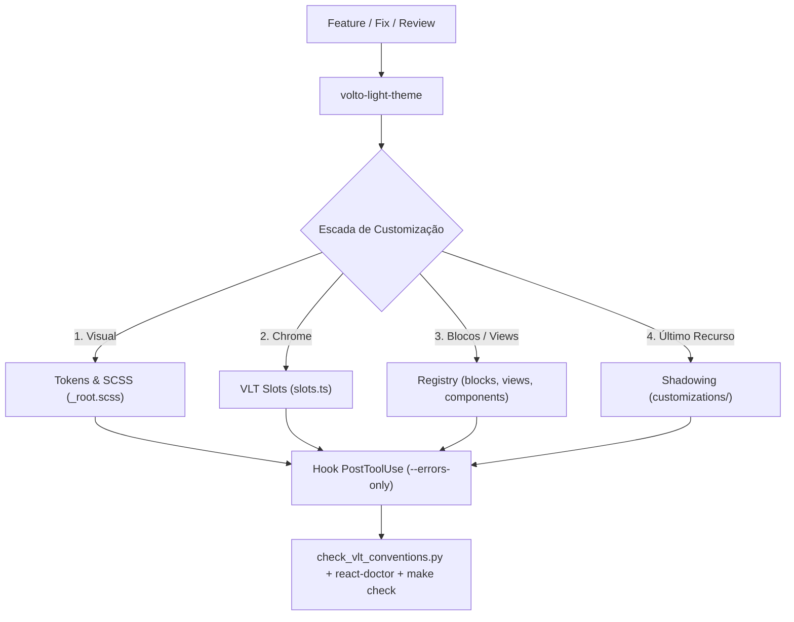

<div align="center">

# volto-light-theme-skills

**Pare de deixar a IA fazer shadowing em Volto Light Theme.**<br>
Regras de arquitetura, tokens semânticos, hooks automáticos e evals para **Plone 6**, **Volto** e **VLT**.

<a href="https://github.com/Rodriguesmath/volto-light-theme-skills/actions"></a>


<table>
<tr>
<td align="center" width="25%"><h3>6 / 6</h3>evals ao vivo no <code>agy</code><br><sub>0 violações VLT</sub></td>
<td align="center" width="25%"><h3>778 tokens</h3>no <code>SKILL.md</code><br><sub><code>0.00</code> de contaminação</sub></td>
<td align="center" width="25%"><h3>0 deps</h3>no linter VLT<br><sub>Python stdlib puro</sub></td>
<td align="center" width="25%"><h3>6 agentes</h3>suportados<br><sub>Claude, Agy, Gemini, Codex, Vibe</sub></td>
</tr>
</table>

**[Instalar](#instalar) · [Antes vs. Depois](#antes-vs-depois) · [Arquitetura](#arquitetura) · [Comandos & Linter](#comandos--linter) · [Créditos](#créditos)**

</div>

---

## Antes vs. Depois

<table>
<tr>
<th width="50%">Sem a skill</th>
<th width="50%">Com <code>volto-light-theme</code></th>
</tr>
<tr>
<td valign="top">

- Faz shadowing de `Header.tsx` em `src/customizations/`
- Importa `Container` e `Pagination` de `semantic-ui-react`
- Sobrescreve `.ui.pagination.menu` com `!important`
- Cola CSS do Figma com `position: absolute`, `320px` e `#26364a`

</td>
<td valign="top">

- Registra slot em `src/config/slots.ts` (`registerSlotComponent`)
- Usa HTML semântico (`<nav>`) ou `@plone/components`
- Estiliza classes próprias sem seletores `.ui.*`
- Reconstrói com Flexbox/Grid, `rem`/`clamp()` e `var(--theme-*)`

</td>
</tr>
</table>

---

## Instalar

Um comando instala as skills MIT deste repositório junto com as skills externas recomendadas (`plone-expert-developer` e `vercel-labs/agent-skills`) para todos os agentes detectados:

```bash
curl -fsSL https://raw.githubusercontent.com/Rodriguesmath/volto-light-theme-skills/main/install.sh | bash
```

<details>
<summary>Outras formas de instalação (Windows, Claude Plugin, Gemini Extension, Codex e Mistral Vibe)</summary>

**Windows (PowerShell):**
```powershell
irm https://raw.githubusercontent.com/Rodriguesmath/volto-light-theme-skills/main/install.ps1 | iex
```

**Plugin nativo do Claude Code (traz apenas as skills MIT deste repo + hooks + comandos slash):**
```text
/plugin marketplace add Rodriguesmath/volto-light-theme-skills
/plugin install volto-light-theme-skills@volto-light-theme-skills
```
> Para incluir também as skills externas no Claude Code, rode:
> `npx skills add https://github.com/codesyntax/plone-expert-developer -a claude-code -g -s '*' -y && npx skills add https://github.com/vercel-labs/agent-skills -a claude-code -g -s '*' -y`

**Extensão nativa do Gemini CLI (traz apenas o contexto deste repo):**
```bash
gemini extensions install https://github.com/Rodriguesmath/volto-light-theme-skills
```
> Para incluir também as skills externas no Gemini CLI, rode:
> `npx skills add https://github.com/codesyntax/plone-expert-developer -a gemini-cli -g -s '*' -y && npx skills add https://github.com/vercel-labs/agent-skills -a gemini-cli -g -s '*' -y`

**OpenAI Codex & Mistral Vibe (stack completa):**
```bash
curl -fsSL https://raw.githubusercontent.com/Rodriguesmath/volto-light-theme-skills/main/install.sh | AGENT=codex bash
curl -fsSL https://raw.githubusercontent.com/Rodriguesmath/volto-light-theme-skills/main/install.sh | AGENT=mistral-vibe bash
```

</details>

---

## Arquitetura



---

## Comandos & Linter

| Recurso | O que faz |
| :--- | :--- |
| **`/vlt-ladder`** | Escolhe o menor degrau da escada VLT antes de escrever código |
| **`/vlt-figma`** | Converte CSS do Figma para Flexbox/Grid, `rem`/`clamp()` e `--theme-*` |
| **`/vlt-audit`** | Roda `check_vlt_conventions.py --strict` e `react-doctor` |
| **Hook `PostToolUse`** | Roda `check_vlt_conventions.py . --errors-only` após edições em `frontend/packages/*/src` |

```bash
# Linter VLT (0 dependências)
python3 skills/volto-light-theme/scripts/check_vlt_conventions.py /caminho/do/projeto --strict

# Evals e testes do repositório
python3 evals/run_evals.py --cli agy
python3 -m unittest discover -s tests -v
```

---

## Créditos

- **Plone & Volto** — [Plone Foundation](https://plone.org/) e comunidade [Volto](https://github.com/plone/volto).
- **Volto Light Theme** — [kitconcept GmbH](https://github.com/kitconcept/volto-light-theme) (`@kitconcept/volto-light-theme`).
- **PortalBrasil & `sc-volto-light-theme`** — [Simples Consultoria](https://github.com/simplesconsultoria) e [PortalBrasil](https://github.com/portalbrasil).
- **Skills Companheiras** — [CodeSyntax](https://github.com/codesyntax/plone-expert-developer) (`plone-expert-developer`), [Vercel Engineering](https://github.com/vercel-labs/agent-skills) (`react-best-practices`, `composition-patterns`, `web-design-guidelines`) e as skills MIT `accessibility-audit` / `accessible-component-review` em `skills/`.
