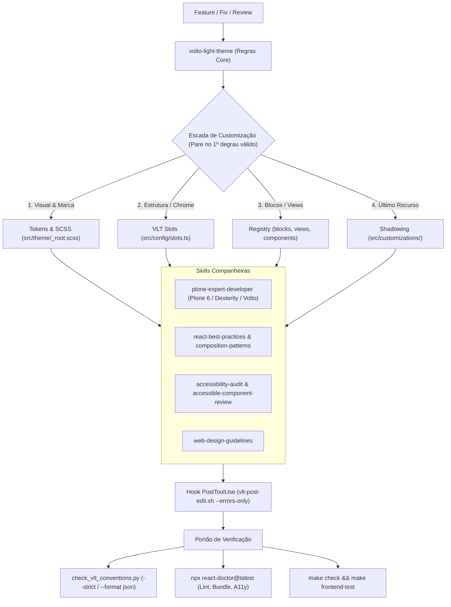

<div align="center">

# volto-light-theme-skills

**Pare de deixar a IA fazer shadowing em Volto Light Theme.**<br>
Regras de arquitetura, tokens semânticos, hooks automáticos e evals para **Plone 6**, **Volto** e **VLT**.

<a href="https://github.com/Rodriguesmath/volto-light-theme-skills/actions"></a>


<table>
<tr>
<td align="center" width="25%"><h3>6 / 6</h3>evals ao vivo no <code>agy</code><br><sub><a href="#linter--evals"><code>evals/run_evals.py</code></a>, 0 violações</sub></td>
<td align="center" width="25%"><h3>778 tokens</h3>no <code>SKILL.md</code> principal<br><sub><code>0.00</code> de contaminação no <code>skill-validator</code></sub></td>
<td align="center" width="25%"><h3>0 deps</h3>no linter VLT<br><sub>Python stdlib puro + <code>--strict</code> / JSON</sub></td>
<td align="center" width="25%"><h3>6 agentes</h3>suportados nativamente<br><sub>Claude, Antigravity, Gemini, Codex, Vibe</sub></td>
</tr>
</table>

**[Instalar](#instalar) · [Antes vs. Depois](#antes-vs-depois) · [Arquitetura](#arquitetura) · [Comandos & Hooks](#comandos--hooks) · [Linter & Evals](#linter--evals) · [Créditos](#créditos)**

</div>

---

Agentes de IA adoram copiar `position: absolute` e hex `#26364a` do Figma, importar `semantic-ui-react` e duplicar arquivos do core em `src/customizations/`. Tudo isso quebra upgrades do `@kitconcept/volto-light-theme` e do `sc-volto-light-theme`.

Esta suíte força o agente a parar no **degrau mais barato da escada de customização** antes de escrever código — e roda verificação estática automática depois de cada edição.

---

## Antes vs. Depois

<table>
<tr>
<th width="50%">Sem <code>volto-light-theme</code></th>
<th width="50%">Com <code>volto-light-theme</code></th>
</tr>
<tr>
<td valign="top">

- Faz shadowing de `Header.tsx` em `src/customizations/`
- Importa `Container` e `Pagination` de `semantic-ui-react`
- Sobrescreve `.ui.pagination.menu` com `!important`
- Cola CSS do Figma com `position: absolute`, `width: 320px` e `color: #26364a`

</td>
<td valign="top">

- Registra slot em `src/config/slots.ts` (`registerSlotComponent`)
- Usa HTML semântico (`<nav>`) ou `@plone/components`
- Estiliza classes próprias sem seletores `.ui.*`
- Reconstrói com Flexbox/Grid, `rem`/`clamp()` e `var(--theme-foreground-color)`

</td>
</tr>
</table>

---

## Instalar

### Comando unificado (Linux / macOS / WSL)

Instala as skills MIT deste repositório junto com as skills externas recomendadas (`codesyntax/plone-expert-developer` e `vercel-labs/agent-skills`) para todos os agentes detectados:

```bash
npx skills add https://github.com/Rodriguesmath/volto-light-theme-skills -a '*' -g -s '*' -y \
  && npx skills add https://github.com/codesyntax/plone-expert-developer -a '*' -g -s '*' -y \
  && npx skills add https://github.com/vercel-labs/agent-skills -a '*' -g -s '*' -y
```

Ou via script (passe `AGENT=claude-code`, `AGENT=codex` ou `AGENT=mistral-vibe` para direcionar a um agente específico):

```bash
curl -fsSL https://raw.githubusercontent.com/Rodriguesmath/volto-light-theme-skills/main/install.sh | bash
```

### Windows (PowerShell)

```powershell
irm https://raw.githubusercontent.com/Rodriguesmath/volto-light-theme-skills/main/install.ps1 | iex
```

### Plugin nativo do Claude Code (skills + hooks + comandos slash)

```text
/plugin marketplace add Rodriguesmath/volto-light-theme-skills
/plugin install volto-light-theme-skills@volto-light-theme-skills
```

> **Nota:** o `/plugin install` instala apenas as skills MIT deste repositório, hooks e comandos slash. Para ter a stack complementar completa (`plone-expert-developer`, `react-best-practices`, `composition-patterns` e `web-design-guidelines`), instale também as skills externas:
>
> ```bash
> npx skills add https://github.com/codesyntax/plone-expert-developer -a claude-code -g -s '*' -y \
>   && npx skills add https://github.com/vercel-labs/agent-skills -a claude-code -g -s '*' -y
> ```

### Extensão nativa do Gemini CLI

```bash
gemini extensions install https://github.com/Rodriguesmath/volto-light-theme-skills
```

> **Nota:** `gemini extensions install` carrega apenas o contexto deste repositório (`volto-light-theme`). Para incluir a stack complementar completa (`plone-expert-developer`, `react-best-practices`, `composition-patterns` e `web-design-guidelines`), instale também as skills externas:
>
> ```bash
> npx skills add https://github.com/codesyntax/plone-expert-developer -a gemini-cli -g -s '*' -y \
>   && npx skills add https://github.com/vercel-labs/agent-skills -a gemini-cli -g -s '*' -y
> ```

### OpenAI Codex & Mistral Vibe

```bash
# OpenAI Codex (inclui .codex/config.toml, .codex/hooks.json e AGENTS.md)
curl -fsSL https://raw.githubusercontent.com/Rodriguesmath/volto-light-theme-skills/main/install.sh | AGENT=codex bash

# Mistral Vibe (usa AGENTS.md + skills)
curl -fsSL https://raw.githubusercontent.com/Rodriguesmath/volto-light-theme-skills/main/install.sh | AGENT=mistral-vibe bash
```

---

## Arquitetura

Toda tarefa passa pela **Escada de Customização** (parando no menor degrau possível), aciona as skills companheiras conforme a camada e termina no portão de verificação automática:



---

## Skills Incluídas (MIT)

| Skill | Escopo | Origem |
| :--- | :--- | :--- |
| [`volto-light-theme`](skills/volto-light-theme/SKILL.md) | Escada de customização VLT, contrato `--theme-*`, slots, blocos/variações, conversão de Figma e linter. | Este repositório (MIT) |
| [`accessibility-audit`](skills/accessibility-audit/SKILL.md) | Auditoria WCAG / axe determinística com fronteiras explícitas de revisão manual. | MIT |
| [`accessible-component-review`](skills/accessible-component-review/SKILL.md) | Semântica nativa, teclado, foco, contraste e regiões ARIA live em componentes reutilizáveis. | MIT |

**Instaladas direto da fonte pelo comando unificado:**
- [`plone-expert-developer`](https://github.com/codesyntax/plone-expert-developer) — CodeSyntax (Plone 6 backend, Volto TypeScript, Classic UI e protocolo `6.docs.plone.org`).
- [`react-best-practices`](https://github.com/vercel-labs/agent-skills), [`composition-patterns`](https://github.com/vercel-labs/agent-skills) e [`web-design-guidelines`](https://github.com/vercel-labs/agent-skills) — Vercel Engineering.
- `react-doctor` — executado sob demanda via `npx react-doctor@latest --verbose --scope changed`.

---

## Comandos & Hooks

- **`/vlt-ladder`** — Decide o menor degrau da escada VLT antes de editar qualquer arquivo.
- **`/vlt-figma`** — Converte CSS do Figma Inspect para Flexbox/Grid, `rem`/`clamp()` e tokens `--theme-*`.
- **`/vlt-audit`** — Roda `check_vlt_conventions.py --strict` e `react-doctor` no projeto atual.
- **Hook `PostToolUse`** ([`hooks/vlt-post-edit.sh`](hooks/vlt-post-edit.sh) e [`.codex/hooks.json`](.codex/hooks.json)) — Executa `check_vlt_conventions.py . --errors-only` automaticamente após edições em `frontend/packages/*/src`, bloqueando `semantic-ui-react` e `.ui.*` sem poluir o contexto com warnings antigos.

---

## Linter & Evals

### `check_vlt_conventions.py`

Linter sem dependências externas: reporta `semantic-ui-react` e `.ui.*` como **error**, e hex hardcoded fora de `_root.scss`, `position: absolute` e overrides em `src/customizations/` sem justificativa como **warning**:

```bash
# Descobre frontend/packages/*/src automaticamente na raiz do projeto
python3 skills/volto-light-theme/scripts/check_vlt_conventions.py /caminho/do/projeto

# Modo estrito (falha em warnings também) e saída JSON para CI/agentes
python3 skills/volto-light-theme/scripts/check_vlt_conventions.py frontend/packages/meu-addon/src --strict --format json
```

### Suíte de Evals (`evals/run_evals.py`)

6 cenários canônicos de VLT em [`evals/cases.json`](evals/cases.json) (testados ao vivo no `agy` com placar **6/6 passed**):

```bash
# Valida o schema dos casos (roda no CI)
python3 evals/run_evals.py --validate-only

# Executa ao vivo contra Antigravity, Claude Code ou Gemini CLI
python3 evals/run_evals.py --cli agy
```

### Testes do repositório

```bash
python3 -m unittest discover -s tests -v
```

---

## Estrutura do Repositório

```text
volto-light-theme-skills/
├── .claude-plugin/          # Manifestos nativos do Claude Code (plugin + marketplace)
├── .codex/                  # Configuração e hook do OpenAI Codex
├── .github/workflows/       # CI (unittest, evals, bash -n, JSON e TOML)
├── commands/                # /vlt-ladder, /vlt-figma, /vlt-audit
├── evals/                   # 6 cenários VLT + runner CLI
├── hooks/                   # Hook PostToolUse (--errors-only)
├── skills/                  # Skills MIT empacotadas
├── tests/                   # Testes unitários do linter, evals e frontmatter
├── AGENTS.md                # Instruções raiz para Codex e Mistral Vibe
├── gemini-extension.json    # Manifesto de extensão do Gemini CLI
├── install.ps1              # Instalador Windows PowerShell
├── install.sh               # Instalador Linux / macOS / WSL
├── LICENSE                  # MIT
└── README.md
```

---

## Créditos

- **Plone & Volto** — [Plone Foundation](https://plone.org/) e comunidade [Volto](https://github.com/plone/volto).
- **Volto Light Theme** — [kitconcept GmbH](https://github.com/kitconcept/volto-light-theme) (`@kitconcept/volto-light-theme`).
- **PortalBrasil & `sc-volto-light-theme`** — [Simples Consultoria](https://github.com/simplesconsultoria) e [PortalBrasil](https://github.com/portalbrasil) (`@portalbrasil/intranet`, contrato de tokens semânticos e arquitetura de mixins SCSS).
- **Skills Companheiras** — [CodeSyntax](https://github.com/codesyntax/plone-expert-developer) (`plone-expert-developer`), [Vercel Engineering](https://github.com/vercel-labs/agent-skills) (`react-best-practices`, `composition-patterns`, `web-design-guidelines`) e as skills MIT `accessibility-audit` / `accessible-component-review` preservadas em `skills/`.
