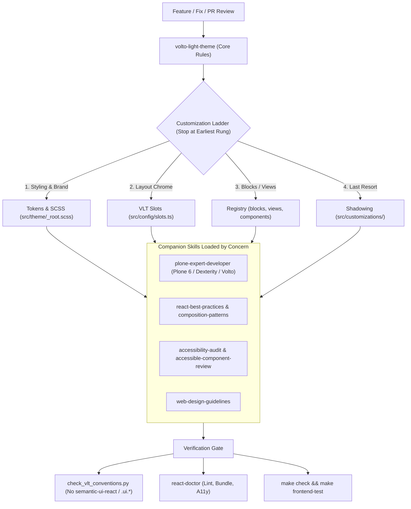

# volto-light-theme-skills

**Upgrade-safe AI agent skills for Plone 6, Volto, and Volto Light Theme.**

AI coding agents default to generic React patterns, inline hex colors, `semantic-ui-react` imports, and `src/customizations/` file shadowing—all of which break upgrades and violate `@kitconcept/volto-light-theme` and `sc-volto-light-theme` conventions. This repository encodes the exact customization ladder, token contracts, registry patterns, and static checks needed to ship clean Volto Light Theme addons on the first pass.

---

## Architecture

The suite pairs a core **Volto Light Theme** skill with specialized Plone, React, and accessibility skills. Every UI change is routed through the **Customization Ladder**—stopping at the lowest-cost, most upgrade-safe rung—before running deterministic verification.



---

## Included Skills

| Skill | Scope | Source / Maintainer |
| :--- | :--- | :--- |
| [`volto-light-theme`](skills/volto-light-theme/SKILL.md) | VLT customization ladder, `--theme-*` token contract, slots, block/listing registration, Figma-to-SCSS rules, and convention checker. | This repo (MIT) |
| [`plone-expert-developer`](skills/plone-expert-developer/SKILL.md) | Plone 6 backend (Python, Dexterity, `plone.restapi`), Volto TypeScript, and Classic UI routing + `6.docs.plone.org` retrieval protocol. | [CodeSyntax](https://github.com/codesyntax/plone-expert-developer) |
| [`react-best-practices`](skills/react-best-practices/SKILL.md) | 40+ React performance rules (bundle size, waterfalls, re-renders, SSR/hydration). | [Vercel Engineering](https://github.com/vercel-labs/agent-skills) (MIT) |
| [`composition-patterns`](skills/composition-patterns/SKILL.md) | Compound components, context interfaces, explicit variants over boolean prop proliferation. | [Vercel Engineering](https://github.com/vercel-labs/agent-skills) (MIT) |
| [`react-doctor`](skills/react-doctor/SKILL.md) | Automated React diagnostics triage (lint, accessibility, dead code, bundle impact). | `react-doctor` |
| [`accessibility-audit`](skills/accessibility-audit/SKILL.md) | Deterministic WCAG / axe page and state audits with explicit manual-review boundaries. | MIT |
| [`accessible-component-review`](skills/accessible-component-review/SKILL.md) | Native semantics, keyboard interaction, focus management, contrast, and ARIA live regions. | MIT |
| [`web-design-guidelines`](skills/web-design-guidelines/SKILL.md) | UI/UX compliance review against Web Interface Guidelines. | [Vercel Engineering](https://github.com/vercel-labs/agent-skills) |

---

## Install

### Using `skills` CLI (recommended)

```bash
npx skills add https://github.com/<your-username>/volto-light-theme-skills
```

### Local symlink (Antigravity / Gemini / Claude Code / Codex)

```bash
git clone https://github.com/<your-username>/volto-light-theme-skills.git ~/volto-light-theme-skills

# Link the core VLT skill (repeat for any companion skill you want active)
ln -s ~/volto-light-theme-skills/skills/volto-light-theme ~/.gemini/config/skills/volto-light-theme
```

---

## Convention Checker

`volto-light-theme` ships with a zero-dependency Python linter that catches `semantic-ui-react` imports and `.ui.*` Semantic UI CSS overrides across any Volto addon:

```bash
# Auto-discovers frontend/packages/*/src from a project root
python3 skills/volto-light-theme/scripts/check_vlt_conventions.py /path/to/plone-project

# Or target a specific addon directly
python3 skills/volto-light-theme/scripts/check_vlt_conventions.py frontend/packages/my-addon/src
```

Exit code is `0` when clean, `1` with `file:line` diagnostics on violations.

---

## Repository Layout

```text
volto-light-theme-skills/
├── LICENSE
├── README.md
└── skills/
    ├── volto-light-theme/
    │   ├── SKILL.md
    │   ├── references/
    │   │   └── mixins-and-tokens.md
    │   └── scripts/
    │       └── check_vlt_conventions.py
    ├── plone-expert-developer/
    ├── react-best-practices/
    ├── composition-patterns/
    ├── react-doctor/
    ├── accessibility-audit/
    ├── accessible-component-review/
    └── web-design-guidelines/
```

---

## Credits & Attribution

This repository builds on the work of the Plone, Volto, and React ecosystems:

- **Plone & Volto** — [Plone Foundation](https://plone.org/) and the [Volto](https://github.com/plone/volto) community.
- **Volto Light Theme** — [kitconcept GmbH](https://github.com/kitconcept/volto-light-theme) (`@kitconcept/volto-light-theme`).
- **PortalBrasil & `sc-volto-light-theme`** — [Simples Consultoria](https://github.com/simplesconsultoria) and [PortalBrasil](https://github.com/portalbrasil) (`@portalbrasil/intranet`, semantic token contracts, and SCSS mixin architecture).
- **Companion Skills** — [CodeSyntax](https://github.com/codesyntax/plone-expert-developer) (`plone-expert-developer`), [Vercel Engineering](https://github.com/vercel-labs/agent-skills) (`react-best-practices`, `composition-patterns`, `web-design-guidelines`), and the respective authors of `react-doctor`, `accessibility-audit`, and `accessible-component-review` (preserved with their original licenses inside `skills/`).
