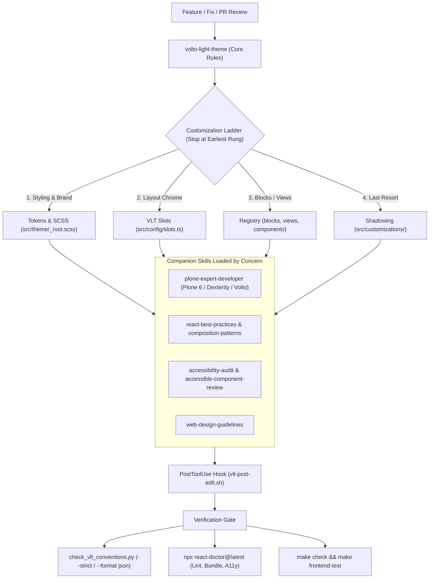

# volto-light-theme-skills

**Upgrade-safe AI agent skills, convention hooks, and slash commands for Plone 6, Volto, and Volto Light Theme.**

AI coding agents default to generic React patterns, inline hex colors, `semantic-ui-react` imports, and `src/customizations/` file shadowing—all of which break upgrades and violate `@kitconcept/volto-light-theme` and `sc-volto-light-theme` conventions. This repository encodes the exact customization ladder, token contracts, registry patterns, and automated enforcement needed to ship clean Volto Light Theme addons on the first pass.

---

## Architecture



---

## Before / After

| Without `volto-light-theme` | With `volto-light-theme` |
| :--- | :--- |
| Shadows `src/customizations/components/theme/Header/Header.tsx` | Registers slot in `src/config/slots.ts` via `registerSlotComponent` |
| Imports `Container` / `Pagination` from `semantic-ui-react` | Uses native HTML/Volto components (`<nav>`, `@plone/components`) |
| Copies `position: absolute; width: 320px; color: #26364a;` from Figma | Rebuilds with Flexbox/Grid, `rem`/`clamp()`, and `var(--theme-foreground-color)` |
| Overrides `.ui.pagination.menu` with `!important` | Styles semantic classes without `.ui.*` selectors |

---

## Install

### Unified Shell Command (Linux / macOS / WSL)

Installs this repository's MIT skills alongside `codesyntax/plone-expert-developer` and `vercel-labs/agent-skills` globally across all detected agents:

```bash
npx skills add https://github.com/Rodriguesmath/volto-light-theme-skills -a '*' -g -s '*' -y \
  && npx skills add https://github.com/codesyntax/plone-expert-developer -a '*' -g -s '*' -y \
  && npx skills add https://github.com/vercel-labs/agent-skills -a '*' -g -s '*' -y
```

Or via `install.sh` (pass `AGENT=claude-code` to target Claude Code only):

```bash
curl -fsSL https://raw.githubusercontent.com/Rodriguesmath/volto-light-theme-skills/main/install.sh | AGENT=claude-code bash
```

### Windows (PowerShell)

```powershell
irm https://raw.githubusercontent.com/Rodriguesmath/volto-light-theme-skills/main/install.ps1 | iex
```

### Native Claude Code Plugin (skills + hooks + slash commands)

```text
/plugin marketplace add Rodriguesmath/volto-light-theme-skills
/plugin install volto-light-theme-skills@volto-light-theme-skills
```

> **Note:** Installing via `/plugin install` bundles only this repository's MIT skills, hooks, and slash commands. To get the full companion stack (`plone-expert-developer`, `react-best-practices`, `composition-patterns`, and `web-design-guidelines`), also install the external upstream skills:
>
> ```bash
> npx skills add https://github.com/codesyntax/plone-expert-developer -a claude-code -g -s '*' -y \
>   && npx skills add https://github.com/vercel-labs/agent-skills -a claude-code -g -s '*' -y
> ```

### Native Gemini CLI Extension

```bash
gemini extensions install https://github.com/Rodriguesmath/volto-light-theme-skills
```

> **Note:** `gemini extensions install` loads only this repository's context (`volto-light-theme`). To include the full companion stack (`plone-expert-developer`, `react-best-practices`, `composition-patterns`, and `web-design-guidelines`), also install the external upstream skills via `install.sh` (or `npx skills add` targeting `gemini-cli`):
>
> ```bash
> npx skills add https://github.com/codesyntax/plone-expert-developer -a gemini-cli -g -s '*' -y \
>   && npx skills add https://github.com/vercel-labs/agent-skills -a gemini-cli -g -s '*' -y
> ```

### OpenAI Codex & Mistral Vibe

Install the full stack (bundled + external companion skills) for **OpenAI Codex**:

```bash
curl -fsSL https://raw.githubusercontent.com/Rodriguesmath/volto-light-theme-skills/main/install.sh | AGENT=codex bash
```

Or for **Mistral Vibe**:

```bash
curl -fsSL https://raw.githubusercontent.com/Rodriguesmath/volto-light-theme-skills/main/install.sh | AGENT=mistral-vibe bash
```

*(Codex hook support is configured in [`.codex/config.toml`](.codex/config.toml) and [`.codex/hooks.json`](.codex/hooks.json); root [`AGENTS.md`](AGENTS.md) is also included for Codex and Mistral Vibe discovery.)*

---

## Included Skills (MIT)

All skills bundled directly in `skills/` carry an explicit **MIT** license:

| Skill | Scope | Source / Maintainer |
| :--- | :--- | :--- |
| [`volto-light-theme`](skills/volto-light-theme/SKILL.md) | VLT customization ladder, `--theme-*` token contract, slots, block/listing registration, Figma-to-SCSS rules, and convention checker. | This repo (MIT) |
| [`accessibility-audit`](skills/accessibility-audit/SKILL.md) | Deterministic WCAG / axe page and state audits with explicit manual-review boundaries. | MIT |
| [`accessible-component-review`](skills/accessible-component-review/SKILL.md) | Native semantics, keyboard interaction, focus management, contrast, and ARIA live regions. | MIT |

### Upstream Companion Skills (Installed via Unified Command)

- **`plone-expert-developer`** — [CodeSyntax](https://github.com/codesyntax/plone-expert-developer) (Plone 6 backend, Volto TypeScript, Classic UI, `6.docs.plone.org` retrieval protocol).
- **`react-best-practices`**, **`composition-patterns`**, **`web-design-guidelines`** — [Vercel Engineering](https://github.com/vercel-labs/agent-skills) (React performance, composition patterns, UI/UX compliance).
- **`react-doctor`** — Invoked directly on demand via `npx react-doctor@latest --verbose --scope changed`.

---

## Slash Commands & Hooks

- **`/vlt-ladder`** — Picks the lowest-rung VLT customization strategy before writing code.
- **`/vlt-figma`** — Converts Figma Inspect CSS to Flexbox/Grid, `rem`/`clamp()`, and `--theme-*` tokens.
- **`/vlt-audit`** — Runs `check_vlt_conventions.py --strict` and `react-doctor` on the current project.
- **`PostToolUse` hook** ([`hooks/vlt-post-edit.sh`](hooks/vlt-post-edit.sh)) — Automatically runs `check_vlt_conventions.py` after file edits in any `frontend/packages/*/src` addon.

---

## Convention Checker CLI

`check_vlt_conventions.py` catches `semantic-ui-react` imports and `.ui.*` selectors as **errors**, and hardcoded hex colors, `position: absolute`, and undocumented `src/customizations/` overrides as **warnings**:

```bash
# Auto-discovers frontend/packages/*/src from a project root
python3 skills/volto-light-theme/scripts/check_vlt_conventions.py /path/to/plone-project

# Fail on warnings too, or emit JSON for CI/agents
python3 skills/volto-light-theme/scripts/check_vlt_conventions.py frontend/packages/my-addon/src --strict --format json
```

---

## Repository Layout

```text
volto-light-theme-skills/
├── .claude-plugin/          # Claude Code plugin & marketplace manifests
├── .github/workflows/       # CI (unit tests, shellcheck/bash -n, JSON validation)
├── commands/                # /vlt-ladder, /vlt-figma, /vlt-audit
├── evals/                   # Canonical VLT evaluation cases
├── hooks/                   # PostToolUse convention hook
├── skills/                  # Bundled MIT skills
├── tests/                   # Unit tests for convention checker & skill frontmatter
├── gemini-extension.json    # Gemini CLI extension manifest
├── install.ps1              # Windows PowerShell installer
├── install.sh               # Linux/macOS/WSL installer
├── LICENSE
└── README.md
```

---

## Credits & Attribution

- **Plone & Volto** — [Plone Foundation](https://plone.org/) and the [Volto](https://github.com/plone/volto) community.
- **Volto Light Theme** — [kitconcept GmbH](https://github.com/kitconcept/volto-light-theme) (`@kitconcept/volto-light-theme`).
- **PortalBrasil & `sc-volto-light-theme`** — [Simples Consultoria](https://github.com/simplesconsultoria) and [PortalBrasil](https://github.com/portalbrasil) (`@portalbrasil/intranet`, semantic token contracts, and SCSS mixin architecture).
- **Companion Skills** — [CodeSyntax](https://github.com/codesyntax/plone-expert-developer) (`plone-expert-developer`) and [Vercel Engineering](https://github.com/vercel-labs/agent-skills) (`react-best-practices`, `composition-patterns`, `web-design-guidelines`).
